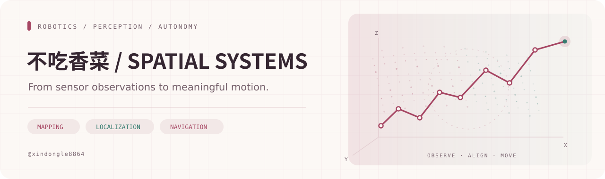
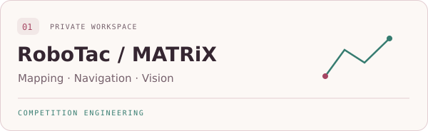
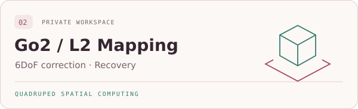

<picture>
  <source media="(prefers-color-scheme: dark)" srcset="assets/hero-dark.svg">
  <source media="(prefers-color-scheme: light)" srcset="assets/hero-light.svg">
  
</picture>

### 机器人 · 三维感知 · 自主导航

把传感器观测转化为地图，让地图支持可靠的行动。

[关于我](#关于我) · [项目实践](#项目实践) · [技术与方法](#技术与方法) · [公开内容](#公开内容)

## 关于我

你好，我是 **不吃香菜**。我的工作重点是四足机器人的建图、定位与导航，也关注三维点云处理和视觉任务。

我喜欢沿着真实的数据链路解决问题：从传感器接口、坐标系与时间一致性，到地图构建、任务执行，再到异常恢复和结果验证。算法之外，配置、运行工具与操作文档也是项目的一部分。

## 项目实践

<table>
<tr>
<td width="50%" valign="top">

<picture>
  <source media="(prefers-color-scheme: dark)" srcset="assets/robotac-dark.svg">
  <source media="(prefers-color-scheme: light)" srcset="assets/robotac-light.svg">
  
</picture>

<strong>比赛任务的感知与执行</strong>

围绕三维建图、多目标导航和视觉搜靶，整理完整的任务入口、地图训练、状态检查与离线操作流程。

<code>ROS 2</code> <code>LIO</code> <code>Planning</code> <code>AprilTag</code>

</td>
<td width="50%" valign="top">

<picture>
  <source media="(prefers-color-scheme: dark)" srcset="assets/go2-dark.svg">
  <source media="(prefers-color-scheme: light)" srcset="assets/go2-light.svg">
  
</picture>

<strong>原生雷达建图与三维纠漂</strong>

围绕地图保存、会话恢复、GICP 回访约束、SE3 位姿图与 AMCL 导航，关注数据完整性和轨迹一致性。

<code>Point Cloud</code> <code>GICP</code> <code>SE3</code> <code>AMCL</code>

</td>
</tr>
</table>

以上工程保存在私有仓库；这里展示项目方向与方法概览。

## 技术与方法

| 层次 | 主要内容 |
| :--- | :--- |
| **感知与空间数据** | 点云处理、坐标变换、源时间检查、AprilTag 与几何视觉 |
| **建图与定位** | SLAM、GICP 配准、SE3 位姿图、地图质量分析、AMCL |
| **规划与执行** | 多目标路线、可通行检查、动态障碍处理、任务状态与恢复 |
| **开发与交付** | Python、C++、ROS 2、Linux、Git、离线工具与技术文档 |

### 最近在关注

- **重访后的地图一致性**：三维约束怎样修正轨迹，以及何时应拒绝修正。
- **建图过程的可恢复性**：输入异常或保存中断后，怎样保留原料并恢复结果。
- **验证与真实效果的距离**：分别记录合成试验、数据回放、仿真与实机结果。

## 公开内容

[**CMC-SpeedRun · 全国大学生数学竞赛速通教程**](https://github.com/xindongle8864/CMC-SpeedRun)

收藏的开源学习项目（Fork），用于数学竞赛学习。机器人项目的源码、录包和运行记录继续保留在私有仓库。

---

Observe carefully. Build practically. Validate honestly. 
不吃香菜 · Robotics &amp; 3D Perception

