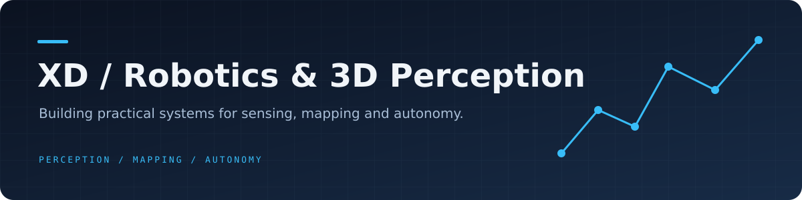
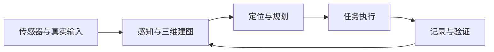

**机器人 · 三维感知 · 自主导航**

从传感器数据到地图，从地图到行动。

## 关于我

我是 **XD**，关注机器人建图、三维点云处理与自主导航，喜欢把算法、传感器接口、运行工具和验证流程连接成可实际使用的工程。

近期工作围绕四足机器人：处理真实输入和时间一致性，构建可恢复的建图链路，研究三维轨迹纠漂，并将操作、诊断与文档一起完善。

## 项目方向

| 项目 | 关注的问题 | 工程内容 |
| --- | --- | --- |
| **RoboTac / MATRiX** | 比赛任务的感知与执行 | 三维建图、多目标导航、视觉搜靶、独立地图训练与离线操作工具 |
| **Go2 · L2 Mapping** | 原生雷达建图与轨迹一致性 | 地图保存、会话恢复、6DoF GICP + SE3后处理、AMCL导航与验证分析 |
| **三维点云** | 空间数据的表示与理解 | 点云处理、重建与质量分析 |

RoboTac 与 Go2 项目保存在私有仓库；此页仅展示方向和工程概览。

## 我关心的工程问题

- **数据可信**：认真处理坐标系、源时间、外参与输入异常。
- **结果可核验**：区分合成实验、数据回放、仿真和实机验证，记录适用边界。
- **过程可恢复**：保留原始数据，明确失败状态，提供诊断与恢复入口。
- **工具可使用**：让配置、操作界面、文档与实际运行行为保持一致。

## 技术视角

Robotics · Spatial Computing · Practical Engineering

